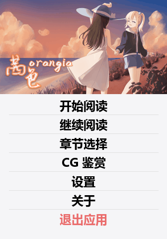
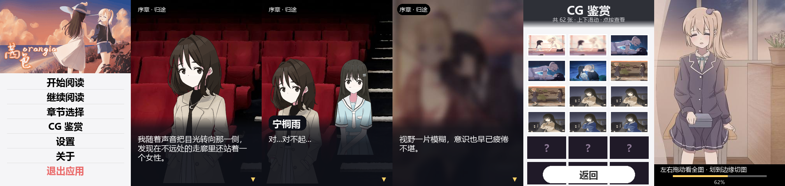

# 茜色 · 小米手环 9 Pro 版

把 PC 版 Ren'Py 视觉小说 **《茜色》** 的全篇剧本，移植成能在 **小米手环 9 Pro**（336×480 矩形 AMOLED）上阅读的 **Vela 快应用**。

**引擎与 UI**
> 剧本解释器与手环适配思路参照开源工程 [mcpotato1123/galgod-band](https://github.com/mcpotato1123/galgod-band)：
> **索引 + 分块剧本的流式阅读器**、固定槽位渲染、`protected` 页面状态、`storage` 存档。

> 界面沿用 [mcpotato1123/limelight-lemonade-jam-miband](https://github.com/mcpotato1123/limelight-lemonade-jam-miband) 的浅色风格：
> 白色卡片、淡黄菜单条、顶部装饰条、半透明对白板。

```
剧本数据  38,319 条指令 / 25 章 / 300 个分块（每块 128 条）
对话      18,747 句（约 36.5 万字），指令可达率 100%
美术      背景 283（512×480 JPEG，全景平移）
          立绘 4 名角色 314 组表情/服装（210×420）+ 主人 8 张表情
          CG 62 张 + 章节卡 16 张（576×480 JPEG，可全景平移/拖动）
分支      2 个菜单
页面      7 个：主页 / 正文 / 章节 / 存档 / CG 鉴赏 / 设置 / 关于
协议      代码 MIT（见 LICENSE）；剧本与美术资源不在 MIT 范围内（见 NOTICE.md）
产物      dist/com.qianse.band.debug.1.0.rpk   11.10 MB
```

> **免责声明**：本项目是非官方的个人移植，仅供学习交流。
> 剧本文字与全部美术资源（背景 / 立绘 / CG）版权归《茜色》原作方所有。
> 本仓库出于「可运行」的需要收录了转码后的资源，请不要用于任何商业用途。
> 本仓库的**代码**部分可自由参考。详见文末「九、版权与开源协议」。



---

## 故事梗概

> 以下为原作设定的简介。

**引子**

黄昏的客车上，「我」被身旁的声音叫醒——宁桐雨正靠在肩上睡得迷迷糊糊。
从这次归途开始，分班、年级大会、图书馆与傍晚的校园，一段从黄昏开始、又在黄昏结束的夏日物语慢慢展开。

**主要角色**

| 角色 | 简介 | 立绘 |
|---|---|---|
| **宁桐雨** | 黑长直，认真又有点嘴硬，和「我」关系亲密 | 177 组表情/服装 |
| **余晓鑫** | 金发双马尾，活泼爱撒娇，叫宁桐雨「小宁」 | 103 组 |
| **杨老师** | 戴眼镜的老师，序盘里负责分班与年级事务 | 11 组 |
| **凌** | 短发，冷静，常出现在傍晚与回忆的场景里 | 15 组 |
| **主人** | 金发、黑裙的单独立绘角色（`xj` 表情） | 8 张表情 |

**全篇结构**

收录原作全部 25 个剧本文件，按文件名顺序串联：

```
Chapter_0–9、Chapter_6_1、Chapter_a–e
Memory_x、bad_memory、true_end
end_1、end_1_1、end_2、extra、dlc、demo2
```

结局（`true_end` / `end_1` / `end_2`）与回忆、番外、DLC 都作为独立章节列在「章节选择」里，
可以从任意一章直接开始读；从主页「开始阅读」则按顺序一路读到底。

---

## 一、目录结构

```
qianse-band/
├─ package.json              npm 脚本与 aiot-toolkit 依赖
├─ LICENSE                   本项目**代码**的 MIT 协议
├─ NOTICE.md                 素材版权说明（哪些内容不在 MIT 范围内）
├─ src/                      快应用源码（Vela 固定目录名）
│  ├─ manifest.json          应用清单：包名/图标/路由/features/designWidth
│  ├─ app.ux                 应用入口
│  ├─ common/
│  │  ├─ vm.js               剧本解释器（s/b/p/h/g/m/j/c/e）
│  │  ├─ reader.js           排版、设置、storage 存档
│  │  ├─ assets.js           ← 生成：图片索引
│  │  ├─ meta_used.json      ← 生成：剧本引用到的背景/CG/立绘清单
│  │  ├─ icon.png            ← 原作窗口图标 gui/window_icon.png
│  │  ├─ img/b/*.jpg         ← 生成：背景 283 张 512×480
│  │  ├─ img/s/<tag>/        ← 生成：整身底图 + 表情叠加层
│  │  ├─ img/w/*.jpg         ← 生成：CG 62 张 + 章节卡 16 张（576×480）
│  │  ├─ img/t/*.png         ← 生成：鉴赏缩略图 96×54
│  │  ├─ img/ui/             ← 生成：原作封面、orangia 字标、装饰条、对白板
│  │  └─ story/
│  │      ├─ index.txt       ← 生成：章节表 + 分块表（JSON 内容，.txt 扩展名）
│  │      └─ chunk-000.txt…  ← 生成：300 个分块，每块 128 条指令
│  └─ pages/
│     ├─ index/              主页：开始 / 继续 / 章节 / CG / 设置 / 关于 / 退出
│     ├─ game/               正文阅读器（引擎核心）
│     ├─ chapters/           章节选择（25 章）
│     ├─ saves/              存档 / 读档（6 个手动槽 + 自动存档）
│     ├─ cg/                 CG 鉴赏（62 张，拖动看全 + 边缘切图）
│     ├─ settings/           设置（字号 / 速度 / 自动播放 / 常亮 / 长按）
│     └─ about/              关于（故事简介 / 移植说明 / 操作提示 + 彩蛋）
├─ tools/
│  ├─ build_story.py         Ren'Py AST → 手环指令流
│  ├─ build_assets.py        背景、立绘拆层、CG、图标、封面、装饰条
│  ├─ check_story.py         分块/跳转/章节/素材引用/可达率校验
│  ├─ rpyclib.py             RPA / RPC2 与 AST 读取器
│  └─ build.js               构建前静态检查 + 构建包装 + 产物校验
└─ preview/                  界面预览图
```

**仓库里已经带了生成好的剧本与美术资源**（`src/common/story/`、`src/common/img/`），
所以只想改代码的话直接 `npm install && npm run build` 就行，不需要原版游戏。
`build_story.py` / `build_assets.py` 是**溯源用**的——它们记录了资源是怎么从原版转出来的。

界面效果预览（`preview/ui-preview.png`，用真实素材按页面 CSS 数值 1:1 合成）：



---

## 二、构建

```bash
npm install                    # 真正的依赖只有 aiot-toolkit
npm run build                  # → dist/com.qianse.band.debug.1.0.rpk
npm run release                # → release 包（需要 sign/ 下的证书）
npm run check                  # 剧本校验（分块 / 跳转 / 章节 / 素材引用 / 可达率）
```

| 命令 | 作用 |
|---|---|
| `npm run build` / `npm run release` | 出 debug / release 包 |
| `npm run check` | 剧本校验：300 块完整性、跳转目标、章节表、素材引用、全图可达 |
| `npm run story` / `npm run assets` | 从 PC 版重新编译剧本 / 重新出图 |

从 Ren'Py 原始资源重新生成（需要 Python 3 + Pillow，以及 PC 版解包结果）：

```bash
set QIANSE_SRC=D:\path\to\QianSe\unpacked
python tools/build_story.py     # 先编译剧本（立绘组合表来自剧本）
python tools/build_assets.py    # 再出图
python tools/check_story.py     # 应输出 RESULT OK
```

> 顺序不能反：`build_assets.py` 要读 `meta_used.json` 里的表情/服装组合，来决定给每个角色生成哪些底图与脸层。
> 解包目录的默认值是仓库上一级的 `unpacked/`（即 Ren'Py 游戏的 `game/` 解开后的内容），也可用 `QIANSE_SRC` 指定。

`tools/build.js` 会优先用 `AIOT` 环境变量指定的 aiot；否则找本机已有的 aiot（开发机上的参考工程），
再不行回退到 `npx aiot`。Windows 上它会在构建前后各清一次 `../.temp_<工程名>`，原因见「五、已知的坑」第 1 条。

---

## 三、安装到手环（以 **Astrobox** 为例）

`dist/` 里的 **debug rpk 可以直接侧载**，不需要签名证书。

1. 手机装 **Astrobox**
2. 【设置】→【账号与安全】→ 登录小米账号 → 导入在小米运动健康绑定的设备 → 连接手环
3. 【探索】→ 点 `安装快应用` → 找到 `com.qianse.band.debug.1.0.rpk`
4. 等 Astrobox 右下角的圆环跑满
5. 手环应用列表里出现 **茜色**

> 官方 FAQ：<https://iot.mi.com/vela/quickapp/zh/guide/other/faq.html>
> 官方真机调试目前只支持 Xiaomi Watch S4，**9 Pro 不在其列**，所以只能走上面这条侧载路径；
> 查看运行日志要用小米运动健康里的「拉取固件日志」。

**release 包**需要签名证书：

```bash
mkdir sign
openssl req -newkey rsa:2048 -nodes -keyout sign/private.pem -x509 -days 3650 -out sign/certificate.pem
npm run release
```

> `sign/` 已在 `.gitignore` 里，**不要把它提交上来**。

---

## 四、运行时的设计

### 屏幕与单位

手环 9 Pro：**336×480、矩形 AMOLED**。
`manifest.json` 里 `designWidth: 336`，所以 **1px = 1 物理像素**，所有 CSS 数值直接按像素写。

### 画面分层

| 层 | 元素 | 位置/尺寸 |
|---|---|---|
| 背景 | 512×480 JPEG，定时推 `left` 往返 | 0,0 · 336×480 裁剪窗 |
| 立绘 | 3 个固定槽位，每槽「底图 + 表情层」 | 见下「立绘」 |
| CG | 576×480 JPEG，定时推 `left` 往返 | 0,0 · 336×480 裁剪窗 |
| 顶部信息 | 章节名 + 日期 | 10,10 · 胶囊底 |
| 对白板 | 渐变半透明图 `board.png` | 300,0 · 336×180 |
| 说话人 | 白字 24px + 深色胶囊 | 300,18 |
| 正文 | 6 个固定槽位 `<text>` | 338 起，行距 = 字号 + 4，宽 300 |
| 继续提示 | `▼` | 454,306 |
| 选项 | 白卡片 | 186 起，每张 52 高 + 10 间距 |

### 剧本数据格式

`index.txt` 是索引（JSON 内容，`.txt` 扩展名是为了避免被当成模块打包），每块 128 条指令，制表符分隔：

| 指令 | 字段 | 含义 |
|---|---|---|
| `s` | 说话人、文本 | 一句台词（说话人为空 = 旁白） |
| `b` | 背景 id | 切背景（同时清空立绘） |
| `p` | 角色、位置、表情、-、-、服装 | 显示/更新立绘，如 `p n c sf12 - - cloth:scf1` |
| `h` | 角色 | 隐藏立绘（`@fg` 清 CG） |
| `g` | CG / 章节卡 id | 全屏 CG |
| `m` | 若干「文本<US>目标」 | 选项菜单 |
| `j` | 下标 | 无条件跳转 |
| `c` | 章节名 | 更新顶部章节胶囊 |
| `e` | — | 全篇结束 |

台词存的是**原始文本**，分页由运行时按当前字号现算。
画面变化**只在真的变化时**才写进指令流，运行时继承上一个状态。

### 排版与分页

正文**不用滚动**，而是在运行时按当前字号切页：

```
cpl   = floor(310 / 字号)          # 每行字数
lineH = 字号 + 4
lpp   = min(6, floor(144 / lineH)) # 每页行数，20px 时是 6 行 ≈ 90 字
```

一句太长就变成多次点击；分页时**均分**（7 行拆 4+3，而不是 6+1），末尾只剩一行的短尾巴会并回上一页。
断行优先落在 `，。！？；：、）」』…—` 之后，避免标点跑到行首。

字号 14–30 时行宽天然 ≤ 310 ≤ 正文框 316，**数学上不会出现意外折行**；
6 个正文槽位的位置/字号/行高由 `s0..s5` 动态注入，不动态增删节点。

### 立绘

原作不是整张立绘，而是 **Ren'Py LayeredImage**：`base`（身体）、`main`（表情/头）、`cloth`（服装）、`mouth`（嘴型）分层。

构建时做了两件事：

1. 按剧本顺序模拟 `show/scene/hide`，得到每个角色**实际出现过的（表情 × 服装）组合**（全篇 314 组）；
2. 对每组服装，取该组所有表情的差异包围盒，把表情区域抽成一张 **210×420 的透明叠加层**，
   底图则是「该服装的默认表情」烘成的整身图。运行时仍是原作那套「底图 + 脸」的合成。

角色裁切窗口取该角色所有图层的**并集包围盒**，再按 210:420 补足宽度，
所以换服装、抬手时不会切到画面外。

`xj`（主人）是特例：它的图层直接指向 `images/x/<表情>.png`，没有独立目录、也没有服装/嘴型分组，
构建时把每张表情整图缩到 210×420，作为 `face_default_<expr>.png`，底图用透明图占位。

同台人数决定显示尺寸与位置：

| 同台人数 | 尺寸 | 位置 |
|---|---|---|
| 1 人 | 200×400 | 居中，top 80 |
| 2 人 | 168×336 | 左 0 / 右 168，top 144 |
| 3 人以上 | 110×220 | 2 / 113 / 224，top 260 |

### 主页

原作标题画面是 **16:9 横图**（`gui/main/main.png`，海滩夕阳、两人牵手）。
主页不裁切、不平移，直接等比缩到 **336×189** 铺在顶部，整张图完整可见；
原作字标 `gui/main/orangia.png` 放在**封面左下角**（和原作构图一致），菜单卡片紧贴封面下沿。

> 封面与卡片之间不要留缝：图片高度 189，卡片也从 189 开始，并让图片多画 2px 压在卡片下面，
> 避免真机亚像素渲染留下一条黑缝。

### 全景背景

背景图是 **512×480 的宽图**，塞进 `overflow: hidden` 的 336×480 裁剪窗里，
`setInterval` 每 100ms 推 3px 的 `left`（30px/s）：走到 -176 反向，回到 0 再反向，来回扫。

**不给 `left` 加 `transition`**：真机上过渡中间态会被画成两个位置叠加，画面中间出现竖向接缝。
步长 3px 是「看起来还在动、又不抖」的折中；改 `game.ux` 里的 `STEP` / `TICK` 即可调速。

换背景时把偏移归零重扫，不会出现「上一张停在一半、下一张从一半开始」。

### 全景 CG

CG 生成成 **576×480 JPEG**（16:9 原图缩到高 480，再居中裁到 576 宽），
正文里和背景同一套机制：`cgclip` 裁剪窗 + `cgwide` 定时推 `left`，在 336 窗口里缓慢来回平移（3px/100ms）。

切 CG / 切场景时重置偏移，不会出现「半张图卡住」。

### CG 鉴赏

列表是 3 列 16:9 缩略图（96×54），共 62 张。

点开大图后：

- 按住**左右拖动**平移看全图，底部进度条指示看到哪一段；
- 拖到最左/最右后继续划，会**切到上一张 / 下一张 CG**；
- 右上角 `×` 关闭；点左右两侧 48px 热区也能分段平移。

所有平移都改 `left`，**不用 `transition`**（真机上补间会画出接缝）。

### 对白板

`board.png` 是一张 **180 高的竖向渐变**：顶部几乎透明（人物腿部透出来），到文字区约 85% 不透明。
之前是实心圆角块，顶边会在人物大腿上切出一条硬缝，而且整块压住腿部显得「人浮在空中」。

### 性能与内存

- 一次只读一个分块（约 5.5 KB），命中已加载块时零 I/O；同块的并发请求会合并等待者
- 分块缓存最多保留 **4 块**（超出按载入顺序淘汰最旧的），每进入一个新块就后台预读下一块
- 打字机用 50ms 一次的时间校正循环（不是每个字一个定时器），并用自增 token 取消过期回调
- 自动存档：每次进入新的一句写一次快照（`writeAuto()`），菜单/读档前也会落盘一次
- 所有点击入口加 400ms 点击锁：Vela 的 click 会冒泡到根节点的「轻触前进」，不加锁一次点击会同时触发按钮和翻页

### 交互

| 操作 | 行为 |
|---|---|
| 轻触任意处 | 文字没打完 → 立即显示完整；本页还有 → 下一页；否则进入下一句 |
| 下滑 / 右上菜单 | 阅读菜单：继续 / 保存 / 读取 / 自动 / 快进 / 回退一句 / 章节 / CG / 设置 / 主页 / 退出 |
| 右滑 | 回退一句 |
| 长按 | 按设置里的「长按画面」：关 / 隐藏界面 / 按住快进 |
| 系统返回手势 | 打开/关闭阅读菜单（不会误退出） |

### 设置项（−／＋ 步进）

入口有两个：主页「设置」、阅读菜单「设置」。改完立刻生效并写盘。

| 设置 | 范围 | 显示 |
|---|---|---|
| **字体大小** | 14 – 30 px，步长 2 | 当前 px 数值 + 实时预览 |
| **文本播放速度** | 0 – 120 毫秒/字，步长 4 | 0 显示「瞬间」 |
| **自动播放** | 0 – 200 毫秒/字，步长 20 | 0 显示「关」 |
| **屏幕常亮** | 开 / 关（默认开） | 走 `@system.brightness` 的 `setKeepScreenOn` |
| **长按画面** | 关 / 隐藏界面 / 按住快进（三态循环） | 防误触用 |

> 没用原生 `<slider>`：参考工程里它**不能把 `value` 绑成实时值**（会变成受控组件、拖动被弹回），
> 所以这里用普通 `div` + `onclick` 的 −／＋ 按钮，任何固件都能用。

### 关于页与彩蛋

关于页是 `<list>` 里一行行 `<text>`：小节标题 17px 加粗、正文 15px，按 38 个半角单位预折行
（CJK 算 2、ASCII 算 1），不依赖自动折行。

#### 彩蛋：连点「关于」7 次

| 按钮 | 作用 |
|---|---|
| 解锁全部 CG | 一次点亮全部 62 张 |
| 标记已通关 | 写入 `cleared` 标记 |
| 清空 CG 记录 | 把 `cgSeen` 清空，方便重试 |
| 关闭 | 收起面板 |

底部另有「序章 / 第二章」两个快捷键，直达对应章节开头。

---

## 五、已知的坑（都已在代码里绕过）

**1. `aiot` 在 Windows 上构建收尾会报 EPERM。**
它先把工程复制到同级 `../.temp_<工程名>` 再编译，收尾用 rimraf 删临时工程，
而里面的 `node_modules` 是软链接（junction），删它必报 `EPERM: operation not permitted`。
此时 **rpk 其实已经生成好了**，但退出码是 1。
`tools/build.js` 在构建前后各清一次临时目录，并在构建后校验产物，遇到「rpk 在、退出码非 0」按成功处理。

**2. 封面和菜单之间出现黑缝。**
封面图高 189px，菜单卡片原本从 197px 开始，中间露出 8px 的页面底色（手表上是黑底）。
现在卡片从 189px 开始、背景改实色 `#f5f5f7`，并让封面多画 2px 与卡片重叠，消掉亚像素发丝线。

**3. 不要给「有子节点」的容器加 `opacity`。**
真机上会整棵子树离屏合成，结果是横向条纹、内容被压扁。所有半透明一律用 `rgba()`。

**4. `data` 不能与 `public / protected / private` 同时出现。**
页面 VM 直接建不起来：界面停住、点了没反应，每次点击只重复抛同一个错。
本工程每个页面**只用 `protected`**，`tools/build.js` 的构建前检查会拦住两者共存的情况。

**5. `<scroll>` / `<div>` 里必须写 `flex-direction: column`。**
Vela 默认是**横向**排列，设置页一度只剩「字体大小」一块，就是因为四张卡片横着排到屏幕外了。

**6. 立绘是分层素材，不能直接当整图用。**
`x` 的默认部件 `f1/cf1/mf1` 是 1.5 倍放大版（1110×1575），和 665×1050 的底图叠加本身就会错位；
这类组合只在 `extra`/`dlc` 的残缺属性调用里出现，构建时已跳过（共 4 张）。

**7. 背景里有 115 张实际是 JPEG 数据，但扩展名仍是 `.png`。**
Ren'Py 常见做法；构建时按内容解码，输出统一转成真正的 JPEG。

**8. 立绘属性会继承上一次 `show` 的状态。**
剧本里 `show n ss3 scs1 sms4` 只写一部分属性，剩下的由引擎沿用；
`build_story.py` 按 show/scene/hide 顺序模拟状态机，不能按「每条 show 独立解析」处理，否则会出现裸体/错装的帧。

**9. 全量素材必须换编码才塞得进 15 MB。**
283 张背景 × 62 张 CG 如果沿用 3 章版的 PNG 调色板，包体约 28–30 MB。
现在背景改成 512×480 JPEG q72（283 张约 6.9 MB），CG/章节卡改成 576×480 JPEG q72（约 2.1 MB），
立绘底图/表情层分别量化到 64/32 色（314 组约 0.8 MB），整包 **11.1 MB**，仍保留背景与 CG 的平移。

**10. `xj` 没有独立素材目录。**
它的 LayeredImage 属性直接映射到 `images/x/<表情>.png`，且没有服装/嘴型分组；
`build_assets.py` 对 `tag == "xj"` 单独处理，否则会去 `images/xj/` 找文件、直接漏掉 8 张表情。

---

## 六、和参考工程不一样的地方（以及为什么）

| 项 | 参考工程 | 本工程 | 原因 |
|---|---|---|---|
| 内容范围 | 全篇 25 章 | **全篇 25 章** | 一致 |
| 背景 | 672 宽 PNG 调色板 | **512 宽 JPEG q72** | 全量 283 张，PNG 会超 15 MB；JPEG 仍保留 176px 平移 |
| CG | 853×480 静态 + 拖动 | **576×480 JPEG，自动全景 + 拖动/切图** | 正文有「呼吸感」，鉴赏页仍可看全 |
| 立绘 | 半身 143×380 | **整身 210×420，按人数缩放** | 整身才像 VN 里的人物 |
| 立绘差分 | 眼睛/眉毛/嘴三层 | **服装底图 + 表情叠加层** | 原作分层是 body/face/cloth/mouth，按服装分组才对齐 |
| 立绘编码 | PNG | **64/32 色调色板** | 全量 314 组，原图约 3 MB，量化后 0.8 MB |
| 主页 | 标题画 | **原作封面整图（336×189）+ 左下 orangia 字标** | 保持原作的构图与字标 |
| 设置控件 | 滑块 + 步进 | **只用 −／＋ 步进** | `<slider>` 的 `value` 绑定在真机不可靠 |

---

## 七、验证情况

| 验证 | 手段 | 结果 |
|---|---|---|
| 剧本完整性 | `tools/check_story.py` | 25 章、300 块、38,319 条指令；跳转/章节/素材引用全部命中；**可达率 100%** |
| 构建前静态检查 | `tools/build.js` | 校验 `data`/`protected` 共存、关于页版本号与 manifest 一致、分块节点数与索引一致 |
| 运行逻辑 | Node + 真实 `vm.js` | 7 个代表性章节起点逐条跑通，章节起始 pc 与标题正确 |
| 构建 | `node tools/build.js` | 产物 **11.10 MB**：283 背景、78 张 CG/章节卡、314 组立绘、300 个分块 |
| 界面 | 真实素材按 CSS 数值合成 | `preview/` 下的六屏预览 |

**仍需真机确认的点**

- 全量 283 张背景 + 62 张 CG 的包体在 9 Pro 上的安装/内存表现
- 立绘按人数缩放的观感（1/2/3 人三档尺寸是否合适）
- CG 的 `<image>` 拖动：`touchmove` 是否派发、坐标字段叫什么都没有文档，已同时挂了拖动 / 轻扫 / 左右热区三条路
- 字号 28–30 时每页只剩 4 行，长句翻页次数会变多

---

## 八、操作提示

- 只想改剧情文字：直接改 `src/common/story/chunk-*.txt`（制表符分隔），或从 PC 版重跑 `npm run story`
- 想改章节顺序/标题：改 `tools/build_story.py` 顶部的 `CHAPTERS`，再跑 story → assets → check
- 想改正文版面：`src/common/reader.js` 顶部的 `TEXT_TOP / TEXT_BOX_W / TEXT_BOX_H / MAX_LINES`，
  同步改 `src/pages/game/game.ux` 里 `.ln` 与 `.name` 的坐标
- 想改字号/速度范围：`src/common/reader.js` 的 `SIZE_MIN/MAX`、`SPEED_MIN/MAX`、`AUTO_MIN/MAX`
- 想改立绘尺寸：`tools/build_assets.py` 的 `SW / SH`，同步改 `game.ux` 的 `sizes`（三档尺寸与 top）
- 想改背景宽度/画质：`build_assets.py` 的 `BG_W`、`save_photo(..., quality=72)`、`canvas.quantize(colors=…)`；
  同步改 `game.ux` 的 `BG_W` 与 `.bgwide` 的 width
- 想改 CG 取景宽度：`build_assets.py` 的 `cover(..., 576, H)`
- 想改主页封面：`build_assets.py` 的 `title_bg` 生成段，同步改 `index.ux` 的 `.bg` 高度与 `.sheet` 的 `top`
- 想改关于页内容：`src/pages/about/about.ux` 的 `ABOUT` 数组与 `MAXU`（每行半角单位数）
- **改版本号要改两处**：`src/manifest.json` 的 `versionName`，以及 `src/pages/about/about.ux` 的 `APP_VERSION`；
  不一致时构建直接失败
- 包名是 `com.qianse.band`；`tools/build.js` 会自动跟随 manifest 取名，不用改别处

---

## 九、版权与开源协议

- **这是非官方的个人移植项目**，与《茜色》原开发商、小米公司均无关联。
- **剧本文字与美术资源**（背景、立绘、CG、封面、图标）版权归原作所有。
  `src/common/story/`、`src/common/img/`、`src/common/icon.png` 都是 PC 版解包并转码而来的衍生文件——
  收录它们只是为了让仓库**能直接构建出可运行的包**。
  请勿用于商业用途；如版权方有异议，删除相应目录即可（代码本身不依赖具体内容，换个剧本照样能跑）。
- **代码部分采用 [MIT 协议](LICENSE)**：`src/pages/`、`src/common/*.js`、`src/app.ux`、
  `tools/`、`src/manifest.json` 以及全部文档，可自由使用、修改、再分发。
  架构思路来自 [galgod-band](https://github.com/mcpotato1123/galgod-band)，
  界面样式参照 [limelight-lemonade-jam-miband](https://github.com/mcpotato1123/limelight-lemonade-jam-miband)。
- ⚠️ **MIT 只覆盖代码，不覆盖素材。** 详见 [NOTICE.md](NOTICE.md)。
- 侧载第三方应用到手表属于非官方途径，**风险自负**。
